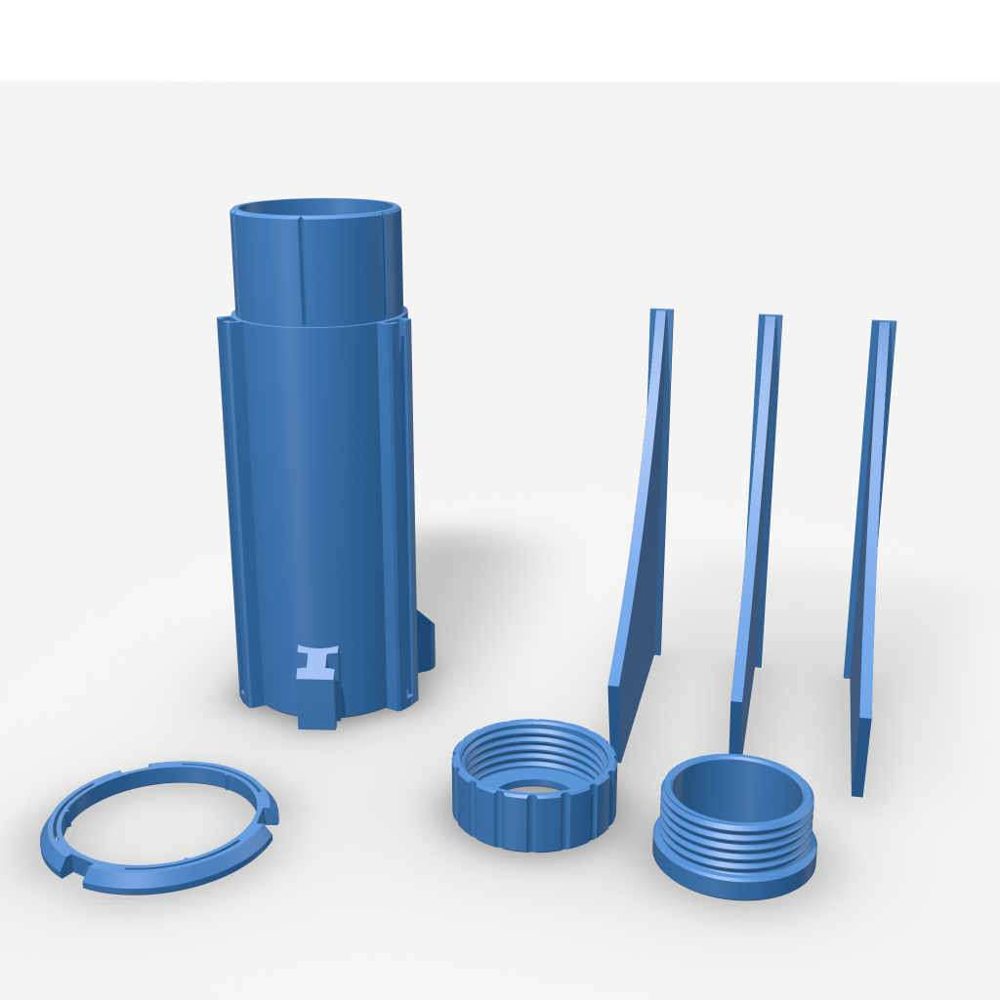
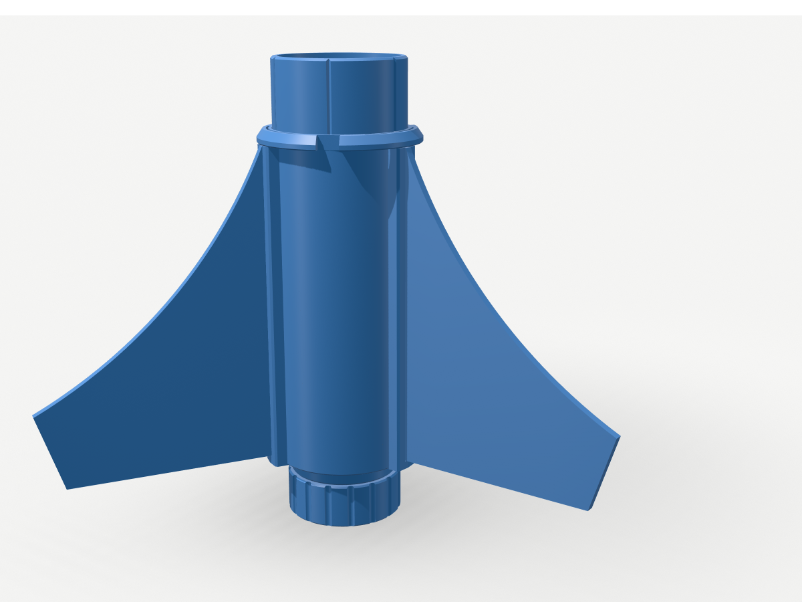
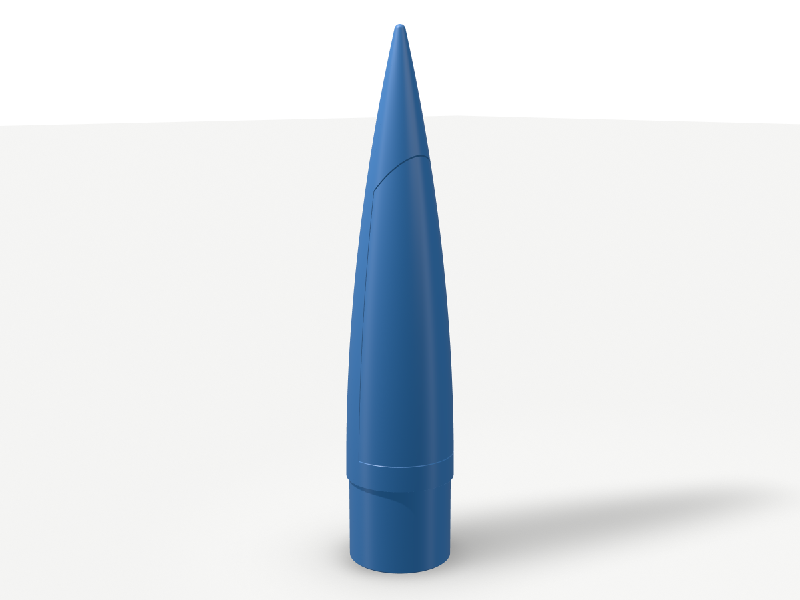
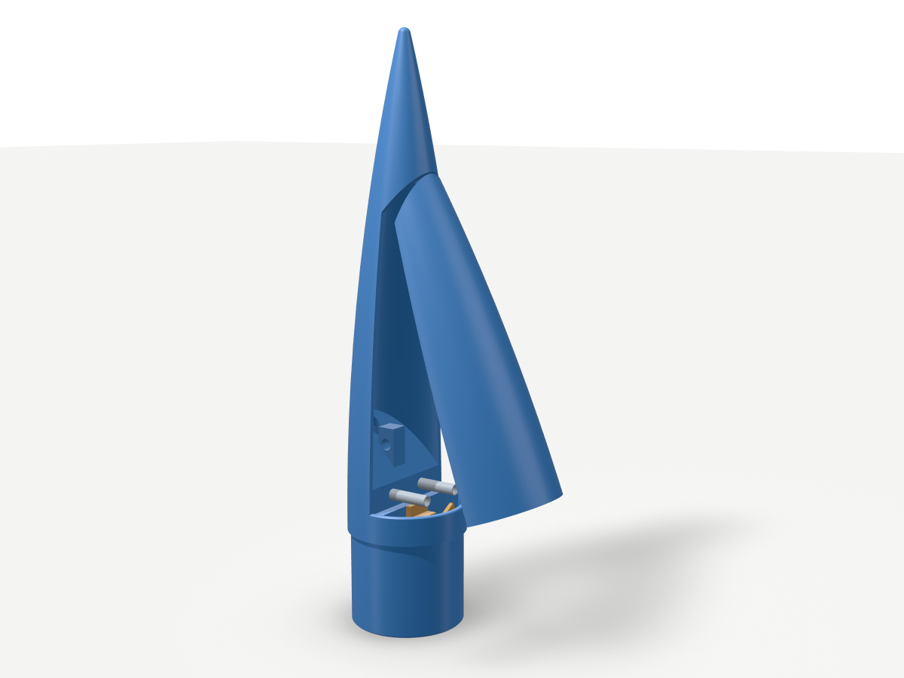

# Estes Scorpio 3D — printable replica parts (ABS)

Replica of the 3D-printed parts of the Estes Pro Series II **Scorpio 3D** (kit #9733),
modelled with [text-to-cad](https://github.com/earthtojake/text-to-cad) (cadgen 0.7.21,
build123d) from the two reference photos in `ref/`.

Scale comes from Estes' published specs: 2 in (50.8 mm) body tube, 29 mm motor
(E16-4 / F15-6), 1/4 in launch rod or 1010 launch rail, 41.5 in (1054 mm) long.
All other dimensions are measured from the photos and scaled to that body diameter.

  

## Files to print

All parts are exported **in print orientation** (drop them on the plate as they are).
All three nose versions are 247.5 mm tall (they fit the K1C's 250 mm and the K1 Max) and share the same
shell. Print one of them: `nose_cone_hook` or `nose_cone_open` (the shock cord attaches to the nose), or the
**side-door nose** (`nose_cone_door_housing` + `nose_cone_door`), which releases the parachute through a
servo-latched door; see [Side-door nose](#side-door-nose-servo-deployment).
Use `3MF/` (preferred) or `STL/`; `STEP/` holds the exact CAD.

| Part | File | Qty | Orientation | Notes |
| --- | --- | --- | --- | --- |
| Fit gauge | `fit_gauge` | 1 | wide end down | **Print first** (see Fits) |
| Nose cone, hook version | `nose_cone_hook` | 1 (either version) | tip up | Closed base with a pilot hole for a screw hook / screw eye |
| Nose cone, open version | `nose_cone_open` | 1 (either version) | tip up | Open base with a bar to tie the shock cord; room inside for clay nose weight |
| Side-door nose, housing | `nose_cone_door_housing` | 1 (with the door) | tip up | Shoulder, band, half-shell and tip; servo mount, spring pins, ramp, tie eye |
| Side-door nose, door | `nose_cone_door` | 1 (with the housing) | standing on its floor block | 5 mm brim; spring pockets and latch groove in the floor block |
| Coupler | `coupler` | 1 | upright | Band with 1010 rail guide and 1/4 in lug |
| Fin can | `fin_can` | 1 | aft face down | 3 external fin housings, motor bore, engine stop, aft guide and lug |
| Fin lock ring | `fin_lock_ring` | 1 | wide (aft) face down | Twist-lock ring that holds the fins (no glue) |
| Fin | `fin` or `plate_fins_x3` | 3 | standing on the trailing edge | `plate_fins_x3` has all three pre-arranged |
| Male retainer | `retainer_male` | 1 | band down | Glues onto the motor tube |
| Female retainer cap | `retainer_female` | 1 | lip down | Screws on, holds the motor |

No part needs supports: every downward face is on the bed, a ledge ≤ 1.7 mm, or
a 45° chamfer/thread flank.

## ABS print settings (Creality K1C / K1 Max, Creality Print)

Start from your ABS preset (`Generic ABS @K1C`, `GTMax ABS @K1 Max` or
`Masterprint ABS @K1 Max`) and check these:

| Setting | Value |
| --- | --- |
| Nozzle / bed | 250–260 °C / 100–105 °C, lid closed, let the chamber warm ~10 min |
| Part cooling | 0–20 % (30–50 % for bridges/overhangs) |
| Layer height | 0.20 mm (0.16 mm for the two retainers: cleaner threads) |
| Walls | 3 (Estes' recommendation); **4 walls on `nose_cone_hook`** (solid material around the hook screw); **5 walls + 40 % infill for both retainers** |
| Infill | 10–15 % gyroid (Estes uses 7 %; ABS fin can is stronger at 15 %) |
| Brim | 5 mm on the nose cone and the fins (tall, narrow footprints); ≥ 3 mm elsewhere |
| Supports | Off |

Bed edges carry 0.6 mm chamfers, so elephant-foot compensation can stay low.

## Fits (check before the big prints)

Two dimensions come from the tubes you bought, not from the photos. They live in
`src/lib/params.py`:

- `BODY_ID = 48.5` mm (assumed: a 2.00 in tube with ~1.15 mm wall). Glued stubs are 48.25 mm and the nose shoulder is 48.05 mm (slip fit).
- `MOTOR_TUBE_OD = 31.0` mm (29 mm motor-mount tube). The bores are 31.4 mm.

The **fit gauge** prints with your own ABS shrinkage, so it measures what you will actually get:

| Step (bottom → top) | 1 | 2 | 3 | 4 | 5 | 6 |
| --- | --- | --- | --- | --- | --- | --- |
| Outer Ø (body tube slides over from the top) | 48.8 | 48.5 | 48.2 | 47.9 | 47.6 | 47.3 |
| Inner Ø (motor tube pushed in from the top) | 30.4 | 30.7 | 31.0 | 31.3 | 31.6 | 31.9 |

Each step is 5 mm tall; the notch marks the top. If the body tube stops snugly on
the step marked *d*, set `BODY_ID = d`. If the motor tube stops on the bore step
*d*, set `MOTOR_TUBE_OD = d`. Then regenerate (see `src/README.md`).

## Non-printed parts

- 2 in body tube (OD 50.8 mm): lower section 229 mm and upper section 457 mm. Any split works; the coupler joins them.
- 29 mm motor-mount tube cut to **114 mm**. It runs from the engine stop to the aft end of the male retainer.
- 24 in parachute, shock cord, aramid leader, recovery wadding.
- For `nose_cone_hook` only, a small steel **screw hook or screw eye**: ≈3.5 mm (#6) wood-screw thread, 10–20 mm of thread. A closed eye is safer than an open hook, or close the hook's gap with pliers after tying the cord. For a 4 mm thread, open the hole to 3.2 mm (or set `NOSE_HOOK_PILOT = 3.2` and regenerate).
- Motors: Estes E16-4 or F15-6 (29 × 114 mm).

## Assembly

The fins are held like on the Estes kit: each fin's T-rail slides into a raised
channel on the fin can **from the forward end** and stops on the channel's closed
aft end. The **fin lock ring** sits on the fin-can stub, just ahead of the
channels. Its three notches line up with the channels (open), and a 60° twist
puts solid ring over the channel ends (locked). Three flexing fingers click into
the stub's grooves at both positions. No glue is needed, so fins can be swapped.

1. **Motor tube:** epoxy the 114 mm tube into the fin-can bore from the aft end until it seats on the engine-stop ledge. 19 mm sticks out aft.
2. **Male retainer:** slide it, band first, over the protruding motor tube, then epoxy it to the tube and to the fin-can aft face.
3. **Shock cord:** tie the aramid leader through the 4 mm hole in the anchor rib inside the fin-can stub.
4. **Lock ring:** slide it down the stub, wide face first, with the fingers' nubs in the grooves, until it sits on the fin can. Turn it until it clicks with the notches over the three fin channels (open).
5. **Lower tube:** glue it onto the stub down to the lock ring. Keep glue off the ring and leave it free to turn; slip a sheet of paper between tube and ring while the glue sets, then pull it out.
6. **Fins:** slide each fin's rail along the body tube into a ring notch and down its channel until it stops at the aft end. Twist the ring 60° until it clicks: the fins are locked. To swap fins, twist back and slide them out forward.
7. **Coupler and upper tube:** glue the coupler between the two tubes. Line up the coupler's rail guide and lug with the fin can's (same angles, centred between two fins) along a straight edge.
8. **Nose:** the shoulder is a slip fit, so add a turn of tape if it is loose.
   - `nose_cone_hook`: the base is closed by a bulkhead with a Ø2.8 mm × 20 mm pilot hole in a ribbed boss. Screw the hook in by hand until its shank sits on the base (a drop of CA in the hole first locks it), then tie the shock cord to it.
   - `nose_cone_open`: tie the shock cord around the bar across the open base. Clay nose weight can be pressed into the cavity if you ever need more stability.
9. **Fly:** check that the ring is clicked into the locked position, insert the motor and screw the cap on; the cap's lip holds the motor.

## Side-door nose (servo deployment)

 

Same mechanism as the reference `Parachute_housing` / `Parachute_door`, on the Scorpio's
nose shape:

- The **door** is the front half of the nose from the band up to just under the tip.
- Its **top tab** tucks inside the tip shell, and its **floor block** sits on the band.
- Two **compression springs** on pins on the housing's split face push the door outward. When it is closed they sit compressed in two pockets in the floor block, and the pin tips locate the block.
- An SG90-class **micro servo** sits in the shoulder with its shaft pointing at the door. Its horn arm stands up in a groove under the door's floor block: that is the latch.
- To open, the servo turns the arm 60° down. The springs kick the door's bottom out about its top. Once it has swung about 32°, the top tab drops out of the tip and the door flies off. The packed parachute (on a 50° ramp that slopes toward the door) helps push it and leaves sideways.

The top joint rises at 50° instead of being level as on the reference, so the tip prints without
supports. A level full-width lip would jam on that joint as the door swings, so the door has a 10 mm
tab at its centre, level with the hinge. The tab is 4 mm tall: enough to hold the door's top against the springs, short enough to let go at ~32°.

**Buy:**
- An MG90S (recommended: metal gears, more torque to pull the arm out against the springs) or SG90 micro servo, plus its single-arm horn trimmed to **15 mm** from the shaft centre to the tip.
- 2 × M2 × 8 self-tapping screws for the servo ears.
- 2 × small **compression springs**: OD 4.5–5.0 mm, ID ≥ 3.4 mm, free length 15–20 mm, solid length ≤ 7 mm. Aim for about 3–5 N each when compressed to ~8.5 mm (≈ 0.3–0.5 N/mm), e.g. 0.4 mm wire × 5 mm OD × 20 mm from a spring assortment.
  - Much stiffer springs make the latch arm drag: the servo has to turn it against their friction. Keep the total under ~10 N.
  - Also usable, and the one used for this build: 0.5 mm wire × 5 mm OD (4 mm ID) × 20 mm, carbon steel. It is stiffer (an estimated 7–10 N each when closed), so use the MG90S and do the scale test in step 1. Avoid 0.6 mm wire or thicker: it can stall the servo.
- Optional: ~30 cm of thin Kevlar thread or braided fishing line to tether the door.
- A controller that drives the servo at apogee (an altimeter with a servo output, or a small Arduino with a barometer), with its battery and a servo extension lead, mounted in the upper tube.

**Assemble:**
1. Prepare the springs:
   - Squeeze each one fully closed 3–4 times so it takes its set now, not in the nose.
   - Check each on a kitchen scale: pressed down to ~8.5 mm long, it should read ≤ 0.5 kg (0.8 kg at most). If it reads more, cut it to ~15 mm free length (about 25 % less force).
   - Push a spring onto each pin, base first, until it sits on the split face. A spring with ID < 3.8 mm screws onto the Ø3.8 mm collar at the pin's root; a looser one (e.g. 4 mm ID) needs a drop of CA on the collar.
2. With the door off, put the servo into the shoulder from the door opening, body first through the plate, so its ears sit on the plate's door-side face. Screw the ears on and lead the cable down through the open shoulder.
3. Fit the horn so the arm points straight up at the "locked" position. Program "open" as 60° from it.
4. Run the shock cord from the fin can up through the Ø7 mm hole in the ramp and tie it, and the parachute, to the tie eye. Pack the parachute on the ramp. Optional: tie the tether from the door's lug (Ø2.5 mm hole on its floor, by the split edge) to the tie eye so the door isn't lost.
5. Close the door: hook its top tab inside the tip, then swing its bottom in over the pins, squeezing the springs into their pockets. Hold it there and send the servo to "locked" so the arm rises into the groove.
   - Bench-test about 10 times with the parachute packed and the flight battery: on "open" the door must jump clear every time.
6. The shoulder slip-fits into the upper tube. Keep the shock cord tied between the fin can and the nose's eye.

The Estes E16-4 / F15-6 still fire their ejection charge. If it pushes the nose off, the nose stays on
the shock cord, and the parachute still leaves through the door when the servo opens it. Time the
servo to open at or before apogee.

**Fit notes:**
- Micro-servo brands differ by about ±0.5 mm. If the arm rubs a groove wall, shift the groove with `NOSE_DOOR_GROOVE_R`, or shim the servo ears with a washer, and regenerate.
- The latch leaves 0.8 mm of play and the top tab 0.6 mm, so the door can't jam.
- The springs push along the servo shaft, not around it, so they can't back-drive the latched arm.

**Stability (estimate, `checks/stability.py`):**
- CP is ≈ 874 mm from the nose tip, i.e. ≈ 168 mm above the fin-can aft face.
- Static margin with `nose_cone_hook`: 2.49 cal at lift-off with the E16-4 and 2.17 cal with the F15-6 (3.0–3.1 cal at burnout).
- With the ~7 g lighter `nose_cone_open`: 2.31 cal (E16-4) and 1.99 cal (F15-6) at lift-off.
- With the side-door nose, a 10 g servo and the springs (electronics not included): 3.19 cal (E16-4) and 2.83 cal (F15-6) at lift-off. That is a little over-stable, so the rocket will weathercock more in wind.
- Before flying, weigh your parts and confirm that the loaded balance point is at least 51 mm (1 caliber) ahead of the CP. Ideally also check in OpenRocket.

Follow the NAR model-rocket safety code and use certified motors only. ABS (Tg ≈ 105 °C)
tolerates motor heat better than PLA. Retire any part with layer splits.

## What was verified

- `checks/check_parts.py` (84 checks, all pass):
  - Every part is one valid, sound, closed solid that sits on Z = 0 and fits 250 mm Z.
  - Key dimensions are measured on the saved STEPs: diameters, bores, both nose versions (hook boss and pilot-hole depth; cord bar and open base), fin-housing channel and aft stop, stub grooves, ring notches and nubs, engine stop, thread crest, nose height.
  - Assembly: no interference between any parts.
  - Clearances: fin rail to housing 0.18 mm; fin to locked ring 0.20 mm; thread flanks 0.247 mm (design 0.25); ring, tube, retainer, motor tube, coupler and nose seated.
  - Fin lock, with a fin moved rigidly:
    - Locked: a 1 mm forward slide hits the ring.
    - Aft: a 0.5 mm slide hits the channel stop.
    - Outward: a 0.5 mm radial pull hits the channel lips.
    - Open: a 20 mm forward slide clears the ring, the fin can and the body tube.
    - The ring's nubs sit in the grooves in both positions.
  - Side-door nose, with the housing, the door, an SG90 envelope and the two springs:
    - No interference with the servo latched or released.
    - The latched arm stops the door from moving outward; released, the arm clears it.
    - The top tab stops the door's top from moving outward, and the spring pins stop it from lifting or sliding sideways.
    - The compressed springs clear their pockets and pins, sit on the split face and seat on each pocket's funnel.
    - Swinging the door's bottom out about its top clears the housing and the released servo, with ≤ 0.6 mm of lift (the joint gap is 0.8 mm). The tab leaves the tip at 32°, so the door flies off.
    - The compartment above the floors holds 150 cm³.
  - Overall length 1064 mm (Estes: 1054 mm).
- Every STL and 3MF is watertight with consistent winding (trimesh: 0 open, 0 non-manifold edges).
- text-to-cad `dfam-check` (FDM limits):
  - No support-requiring overhangs.
  - Walls are ≥ 1.6 mm at p05 on every part except the lock ring, whose 1.2 mm detent fingers are flexures by design (~1 % bending strain at full flex).
  - The only thinner samples are the 45° knife edges at thread run-outs and the chamfered lug/guide tips.
  - Small holes (lug Ø6.9 mm, cord Ø4 mm, nose hook pilot Ø2.8 mm, door tether Ø2.5 mm) are above the 2 mm FDM minimum.

## Assumptions and deviations

- The photos have no dimensions, so lengths are ±5 % estimates:
  - nose 207.5 mm exposed + 40 mm shoulder (shortened ~4 mm to fit the K1C)
  - fin root 114.6 mm, span 83 mm
  - fin can 118 mm + 30 mm stub (5 mm lock ring + 25 mm tube engagement)
  - coupler 38 + 26 + 38 mm
- The nose is a tangent ogive; that profile fits the photo silhouette better than a cone or a Von Kármán.
- The six Estes fin styles are not all reproduced. This is the style in your photos: concave swept leading edge with a slanted tip.
- The fin retention follows the Estes kit video (fins slide in from the front into raised channels, and a twist ring locks them).
  The exact sizes are my own functional design: channel and rail fit, ring detents, engine stop, cord anchor, retainer threads (45°-flank, 2.5 mm pitch, 37 mm) and 1010 guide sizes.
