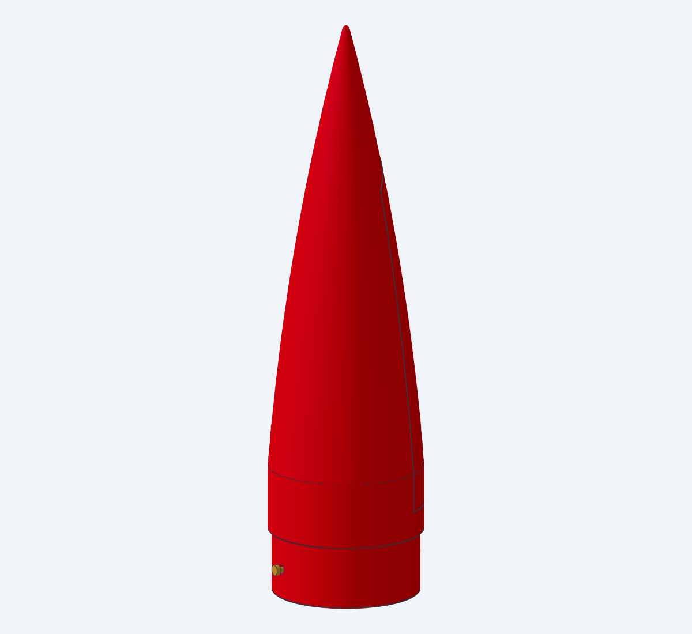
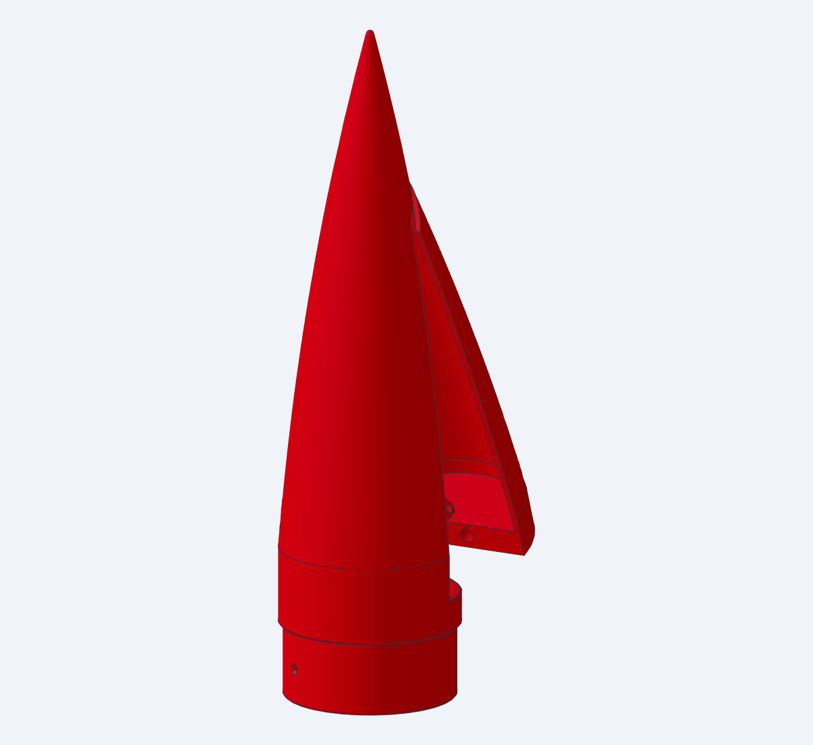

# Helios side-door nose

 

The Scorpio side-door nose (Foguete-Scorpio, `nose_cone_door_*`) resized to replace
`../cone.stl` on the 65.52 mm Helios airframe:

- A TowerPro MG90S servo in the shoulder holds a side door shut with its arm.
- On "open" the arm turns 60° down. Two springs kick the door's bottom out, it swings about its top, and after ~26° its top tab leaves the tip and the door flies off.
- The parachute then leaves sideways off a 50° ramp.

Same outside as `cone.stl`, within ±0.13 mm from the rim up to z 235, 14 mm below its tip. The tip is blunted (R 1.5), so the nose ends 4.4 mm lower.

## Files

| Print | File | Qty | Orientation | Mass (ABS, solid) |
|---|---|---|---|---|
| Housing: shoulder, band, half-shell, tip, servo slot, spring pins, ramp, tie eye, screw pads | `STL/helios_nose_door_housing.stl` (also `3MF/`, `STEP/`) | 1 | upright, shoulder on the bed. 244.5 mm tall: K1 Max, or the K1C (250) | 71 g |
| Door: half-shell, top tab, floor block with the latch groove, spring pockets and swing relief, tether lug | `STL/helios_nose_door.stl` (also `3MF/`, `STEP/`) | 1 | standing on its floor block, 5 mm brim | 38 g |
| Servo keeper: holds the servo up in its slot | `STL/helios_nose_servo_keeper.stl` (also `3MF/`, `STEP/`) | 1 | on its tabs (flat face down) | 5 g |

The first version's files are in `_scratch/v1_printed/`; its servo could not be fitted (see "Servo mount" below). The door from the first version still fits this housing. The current door only adds a swing relief, so it doesn't scrape the band as it opens (see "Swing relief" below).

`STEP/helios_nose_door_assembly.step` is the assembly preview: door closed, servo envelope in its slot with the keeper under it, springs compressed and the two screws. Source is in `src/` (`lib/params.py` holds every number), checks are in `checks/`.

Print in ABS, 0.2 mm layers, no supports. The only flat overhangs are:
- the 23.3 mm bridge over the servo slot. If it sags, trim it flat: the servo must slide up to it;
- the 5 × 7 mm roofs of the keeper's two tab pockets;
- the 3.4 mm roof of the latch groove;
- the door's two swing-relief strips: 0.9 mm off the bed at the split edge, rising at 3.8°. The middle of the door's bottom stays on the bed;
- the 0.88 mm ledge of the shoulder's seat face. It steps out to the skirt at 45°, because a 1.64 mm flat ledge, as on `cone.stl`, sags.

## Fit in the airframe

Measured against `../Mbody.stl` (see `checks/check_meshes.py`):
- **Shoulder:** Ø62.24 × 26.21 mm, the same spigot as `cone.stl` and the clamshell. It sits in Mbody's forward socket with 0.12–0.16 mm radial clearance, and its face lands on the rim.
- **Joint:** the skirt is flush with the tube (0.001 mm).
- **Depth stop:** the shoulder's base stops 1.9 mm above Mbody's bead.
- **Avionics bay:** the bay's forward face is 1.1 mm below that base. The servo stays inside the nose (lowest point z 19.0), and the keeper's underside is 0.2 mm above the base.
- **Orientation:** put the nose's **shock-cord hole** (in the ramp, by the split plate) **over Mbody's cord-anchor tunnel** (airframe θ 0). Then the two screw pilots sit at θ 90° and 270°, **13.21 mm below the tube's forward rim**, the same holes as the clamshell nose. If your tube already has the clamshell's holes, this nose uses them.

## Buy

- **Servo:** TowerPro MG90S with its stock single-arm horn, **not trimmed** (17.25 mm from the shaft centre to the tip). The slot is sized to the one measured here (see "Servo mount"); an SG90 or another clone will not fit it. Its 2 × M2 × 8 self-tappers go into the keeper; the ears need no screws.
- **2 × compression springs:**
  - The 0.5 × 5 × 20 mm springs you bought work (OD ≤ 5.0, ID ≥ 3.4, free length 15–20 mm).
  - The pockets here are 3 mm deeper than on the Scorpio, so the springs close to **11.4 mm** instead of 8.4. With 0.5 mm wire that is an estimated 5–7 N each.
- **Airframe screws:** 2 × **M2.5 × 8** self-tapping, pan head. **Not × 10**: an 8 stops 0.4 mm short of the blind pilot's floor.
- **Shock cord:** Ø4 mm Kevlar, the same as the clamshell. It is anchored in Mbody's tunnel, not in the nose.
- **Optional:** ~30 cm of thin Kevlar thread to tether the door.

## Assemble

1. **Springs:**
   - Squeeze each one fully closed 3–4 times so it takes its set.
   - On a kitchen scale, pressed to **11.5 mm** long, each should read about 0.6 kg or less (0.8 kg at most). Cut it shorter if it reads more.
   - Push one onto each pin until it sits on the split face. A 4 mm-ID spring is loose on the Ø3.8 collar, so put a drop of CA on the collar.
2. **Servo:** it goes in from the shoulder's open base with the horn already on, and the door off.
   - On the bench, power the servo to "locked". Press the single-arm horn on so the arm points straight across the case's width, at right angles to its long side, and screw it on.
   - Hold the servo below the shoulder with the shaft toward the door side and the arm pointing up at the tip. The case end nearer the shaft goes on the shock-cord hole's side.
   - Slide it straight up into the slot until the case stops against the slot's roof. The two ears go up the narrow channel and sit against the door-side plate.
   - Push the keeper up under it, its two tabs into their pockets, and drive the servo's two M2 × 8 screws up through the tabs.
   - Lead the cable down out of the shoulder toward the avionics bay.
3. **"Open":** program it as 60° from "locked". The arm can swing either way; it drops out of the groove after about 40°.
4. **Shock cord and chute:**
   - From Mbody's anchor tunnel, run the shock cord up through the nose's open shoulder and the Ø8 hole in the ramp.
   - **Tie the parachute to the cord, not to the nose.** The tie eye on the ramp is only for the door tether and to keep the bundle in place.
   - Pack the chute on the ramp. The compartment holds 254 cm³.
5. **Close the door:**
   - Hook its top tab inside the tip, then swing the bottom in over the pins, squeezing the springs into their pockets.
   - Hold it there and send the servo to "locked".
6. **Fit the nose:**
   - Push it into Mbody until the shoulder face is down on the rim, with the cord hole over the anchor.
   - Drill Ø3.2 through the **tube wall only**, 13.21 mm below the rim at the two pilots (skip this if the holes exist), and drive the M2.5 × 8 screws in.
7. **Bench test:** do it about 10 times, with the chute packed and the flight battery. On "open" the door must jump clear every time.

## Notes

- **Recovery load path:** the shock cord is anchored in Mbody, as the clamshell requires. Once the door is gone, the cord turns toward the opening over the solid corner where the split plate meets the ramp. That corner load pushes the nose sideways into its socket, not out of it.
- **Venting:** the door's joint gaps vent the nose. Don't tape or seal them. The nose cavity is also open to the avionics bay through the shoulder.
- **Latch loads:** the springs push along the servo shaft, so they can't back-drive the latched arm. Releasing costs the servo only friction: an estimated 70 N·mm out of an MG90S's ~216 N·mm stall.
- **Swing relief:** the door swings about its top, 152 mm above its bottom. For the first ~10° the bottom near the split dips before it rises, by up to (13.7 − x)² / 305 mm: 0.6 mm at the split edge. The first door dragged its two bottom corners across the band's top face, lifting against its tab to get past. Its bottom is now raised beyond 13 mm either side of the centre line, 0.9 mm at the split edge running out to nothing at the hinge line (x 13.7). The middle never passes over the band ring.
  - A first-version door can be fixed the same way by sanding. On its bottom face, sand the two side strips more than 13 mm from the centre line: 0.9 mm off at the split edge, running out to nothing 13.5 mm in from it.
- **Servo mount:** the first version could not be assembled. Its servo had to go in bottom-first through a 10 mm plate from the door side, which needs about 32 mm of room where there are 22, and it was sized from SG90 heights, which put the MG90S's arm 5–8 mm past the groove. Now the servo lies across the nose and slides up from the shoulder base. The spring load presses its ears onto the plate instead of pulling on screws, and the keeper stops it dropping out under boost.
  - Measured on the servo used (calipers, horn pressed on): ear underside 17.5 mm above the case bottom, ears 2.5 mm thick; arm top face 34.3 mm, arm 2.0 mm thick; arm 17.25 mm from the shaft centre to its tip, 5 mm wide; shaft centre 10 mm from the case's near end; case 22.8 × 12 mm. Ear span 32.5 mm from TowerPro's drawing.
  - A different servo or horn changes where the arm sits: re-measure, update `src/lib/params.py` and rebuild.
- **Mass:**
  - The printed nose is ~114 g solid ABS (less with real infill), plus ~13 g of servo, springs and screws. `cone.stl` is ~80 g.
  - A heavier nose moves the CG forward, which adds stability, but the total mass goes up. Re-run your OpenRocket file.
- **Changes from the Scorpio version:**
  - The outside follows `cone.stl`.
  - The two screw pads were added.
  - The shock-cord hole moved to the ramp root.
  - The spring pockets are 3 mm deeper, with the servo 3 mm further out to make room.

## What was checked

- `checks/check_door.py` (62 checks, all pass, run in the cadgen environment):
  - All three parts are single valid, closed solids sitting on z = 0.
  - Shoulder radius and wall, rim face height, skirt radius, ogive radius at z 150, the screw pads and blind pilots at both azimuths, and that the screw length stops short of the pilot floor.
  - A Ø4 cord path from the shoulder base up through the cord hole clears the housing.
  - No interference between the housing, door, keeper, servo (latched and released) and screws.
  - The servo, horn on and arm up, slides from fully below the shoulder base up into its slot without touching the housing (every 0.5 mm). Its ears bear on the mount plate, and it can't move 0.5 mm up, down, sideways or along its shaft without hitting the slot, the keeper or the plate.
  - The arm stands 4 mm up the groove with 3 mm to its roof, and swings 60° either way with the door shut without touching anything. Released, its tip is 4.6 mm below the door's floor.
  - The keeper's tabs sit on their pockets' roofs, its screws stop 1 mm short of their pilots' floors and bite 6.5 mm, and it stays above the shoulder base.
  - The springs clear their pockets and pins, bear on the split face and seat on the funnels.
  - The latched arm holds the door; released, it clears it. The tab holds the door's top, and the pins stop lifting and sideways shift.
  - The door swings about its hinge from 0.5° to 20°, every 0.5°, touching the housing nowhere and needing no lift, and flies off at 26°.
- `checks/check_meshes.py` (6 checks, all pass, run with trimesh):
  - Every STL and 3MF is watertight with consistent winding. The keeper's meshes come from OCCT's mesher, because cadgen's tessellator left open edges on its outline.
  - The Mbody fit numbers above, and the outer radius within 0.13 mm of `cone.stl`.
- text-to-cad `dfam-check`:
  - No support-requiring overhangs beyond the bridges listed under Files.
  - Walls are ≥ 2 mm at p05 on both parts. The thinner samples are the knife edge where the cord hole cuts the 50° ramp, the 1 mm floor behind each pilot (by design) and the tab edges.

## Video

`video/helios_side_door_deploy.mp4` (28 s, 1080p) shows the whole deployment:
- the assembled Helios, with this nose in place of `cone.stl`;
- a see-through close-up of the latch;
- the arm turning 60°, the spring kick and the door flying off at 26°;
- the chute sliding off the ramp, the canopy opening, and the descent.

The video was made from the first version: its servo is the old, unbuildable layout (upright, ears on the door side). The door's motion is unchanged. The latch, springs, hinge axis, release angle and cord path come from the CAD numbers. The parachute, the door's free flight and the timing are illustrative; the kick is slowed down.

Regenerate with:
- `video/export_parts.py` (cadgen environment), which writes the servo/horn/screw meshes and `scene.json`;
- `video/make_video.py` (PyVista; see its docstring for the `uv run` line). `--stills 9,12` renders single frames.

Rebuild after changing `src/lib/params.py` (from `src/`; `CG="uvx --no-config --managed-python --python 3.13 --from cadgen==0.7.21"`):

```
$CG python helios_nose_door_housing.py
$CG python helios_nose_servo_keeper.py
$CG python helios_nose_door.py
$CG python helios_nose_door_assembly.py
cd .. && $CG python checks/check_door.py
uv run --no-project --with trimesh --with scipy --with shapely --with networkx --with rtree --with lxml python checks/check_meshes.py
```

Then refresh CAD Explorer's hidden `STEP/.*.step.glb` sidecars (from `_nose_door`, with the CAD skill's `scripts/step`):

```
python <cad skill>/scripts/step STEP/helios_nose_door_assembly.step --kind assembly
python <cad skill>/scripts/step STEP/helios_nose_door_housing.step STEP/helios_nose_door.step STEP/helios_nose_servo_keeper.step --kind part
```
