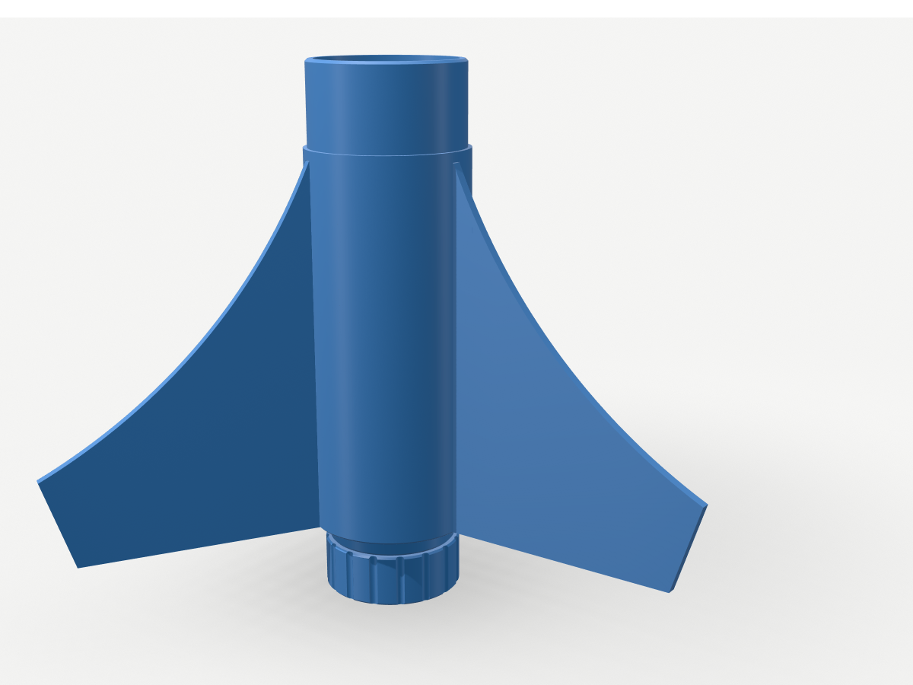

# Estes Scorpio 3D — printable replica parts (ABS)

Replica of the 3D-printed parts of the Estes Pro Series II **Scorpio 3D** (kit #9733),
modelled with [text-to-cad](https://github.com/earthtojake/text-to-cad) (cadgen 0.7.21,
build123d) from the two reference photos in `ref/`.

Scale comes from Estes' published specs: 2 in (50.8 mm) body tube, 29 mm motor
(E16-4 / F15-6), 1/4 in launch rod or 1010 launch rail, 41.5 in (1054 mm) long.
All other dimensions are measured from the photos and scaled to that body diameter.

  

## Files to print

All parts are exported **in print orientation** (drop them on the plate as they are).
Use `3MF/` (preferred) or `STL/`; `STEP/` holds the exact CAD.

| Part | File | Qty | Orientation | Notes |
| --- | --- | --- | --- | --- |
| Fit gauge | `fit_gauge` | 1 | wide end down | **Print first** (see Fits) |
| Nose cone | `nose_cone` | 1 | tip up | 247.5 mm tall: fits the K1C (250 mm) and the K1 Max |
| Coupler | `coupler` | 1 | upright | Band with 1010 rail guide and 1/4 in lug |
| Fin can | `fin_can` | 1 | aft face down | 3 T-slots, motor bore, engine stop, aft guide and lug |
| Fin | `fin` or `plate_fins_x3` | 3 | standing on the trailing edge | `plate_fins_x3` has all three pre-arranged |
| Male retainer | `retainer_male` | 1 | band down | Glues onto the motor tube |
| Female retainer cap | `retainer_female` | 1 | lip down | Screws on, holds the motor |

No part needs supports: every downward face is on the bed, a short bridge
(≤ 8.5 mm: fin-slot tops), a ledge ≤ 1.7 mm, or a 45° chamfer/thread flank.

## ABS print settings (Creality K1C / K1 Max, Creality Print)

Start from your ABS preset (`Generic ABS @K1C`, `GTMax ABS @K1 Max` or
`Masterprint ABS @K1 Max`) and check these:

| Setting | Value |
| --- | --- |
| Nozzle / bed | 250–260 °C / 100–105 °C, lid closed, let the chamber warm ~10 min |
| Part cooling | 0–20 % (30–50 % for bridges/overhangs) |
| Layer height | 0.20 mm (0.16 mm for the two retainers: cleaner threads) |
| Walls | 3 (Estes' recommendation); **5 walls + 40 % infill for both retainers** |
| Infill | 10–15 % gyroid (Estes uses 7 %; ABS fin can is stronger at 15 %) |
| Brim | 5 mm on the nose cone and the fins (tall, narrow footprints); ≥ 3 mm elsewhere |
| Supports | Off |

Bed edges carry 0.6 mm chamfers, so elephant-foot compensation can stay low.

## Fits (check before the big prints)

Two dimensions come from the tubes you bought, not from the photos. They live in
`src/lib/params.py`:

- `BODY_ID = 48.5` mm (assumed: a 2.00 in tube with ~1.15 mm wall). Glued stubs are 48.25 mm and the nose shoulder is 48.05 mm (slip fit).
- `MOTOR_TUBE_OD = 31.0` mm (29 mm motor-mount tube). The bores are 31.4 mm.

The **fit gauge** prints with your own ABS shrinkage, so it measures what you will actually get:

| Step (bottom → top) | 1 | 2 | 3 | 4 | 5 | 6 |
| --- | --- | --- | --- | --- | --- | --- |
| Outer Ø (body tube slides over from the top) | 48.8 | 48.5 | 48.2 | 47.9 | 47.6 | 47.3 |
| Inner Ø (motor tube pushed in from the top) | 30.4 | 30.7 | 31.0 | 31.3 | 31.6 | 31.9 |

Each step is 5 mm tall; the notch marks the top. If the body tube stops snugly on
the step marked *d*, set `BODY_ID = d`. If the motor tube stops on the bore step
*d*, set `MOTOR_TUBE_OD = d`. Then regenerate (see `src/README.md`).

## Non-printed parts

- 2 in body tube (OD 50.8 mm): lower section 229 mm and upper section 457 mm. Any split works; the coupler joins them.
- 29 mm motor-mount tube cut to **114 mm**. It runs from the engine stop to the aft end of the male retainer.
- 24 in parachute, shock cord, aramid leader, recovery wadding.
- Motors: Estes E16-4 or F15-6 (29 × 114 mm).

## Assembly

1. **Fins:** slide each fin's T-rail into a fin-can slot from the aft end until it hits the slot top. Weld it with ABS slurry (ABS scraps dissolved in acetone) or medium CA.
2. **Motor tube:** epoxy the 114 mm tube into the fin-can bore from the aft end until it seats on the engine-stop ledge. 19 mm sticks out aft.
3. **Male retainer:** slide it, band first, over the protruding motor tube, then epoxy it to the tube and to the fin-can aft face. Its band covers the fin-rail ends, which locks the fins in.
4. **Shock cord:** tie the aramid leader through the 4 mm hole in the anchor rib inside the fin-can stub.
5. **Body:** glue the lower tube onto the fin-can stub and the coupler between the two tubes. Line up the coupler's rail guide and lug with the fin can's (both sit at the same angle, centred between two fins) along a straight edge.
6. **Nose:** tie the shock cord to the bar across the nose shoulder. The shoulder is a slip fit, so add a turn of tape if it is loose. The hollow nose can take clay ballast.
7. **Fly:** insert the motor and screw the cap on; the cap's lip holds the motor.

**Stability (estimate, `checks/stability.py`):**
- CP is ≈ 863 mm from the nose tip, i.e. ≈ 175 mm above the fin-can aft face.
- Static margin is 2.25 cal at lift-off with the E16-4 and 1.92 cal with the F15-6 (2.7–2.9 cal at burnout).
- Before flying, weigh your parts and confirm that the loaded balance point is at least 51 mm (1 caliber) ahead of the CP. Ideally also check in OpenRocket.

Follow the NAR model-rocket safety code and use certified motors only. ABS (Tg ≈ 105 °C)
tolerates motor heat better than PLA. Retire any part with layer splits.

## What was verified

- `checks/check_parts.py` (33 checks, all pass):
  - Every part is one valid, sound, closed solid that sits on Z = 0 and fits 250 mm Z.
  - Key dimensions are measured on the saved STEPs: diameters, bores, slot, engine stop, thread crest, nose height.
  - Assembly: no interference between any parts.
  - Clearances: fin rail to slot 0.20 mm; thread flanks 0.247 mm (design 0.25); retainer, motor tube, coupler and nose seated.
  - Overall length 1059 mm (Estes: 1054 mm).
- Every STL and 3MF is watertight with consistent winding (trimesh: 0 open, 0 non-manifold edges).
- text-to-cad `dfam-check` (FDM limits):
  - No support-requiring overhangs.
  - Walls are ≥ 1.9 mm at p05. The only thinner samples are the 45° knife edges at thread run-outs and the chamfered lug/guide tips.
  - Small holes (lug Ø6.9 mm, cord Ø4 mm) and bridges are within limits.

## Assumptions and deviations

- The photos have no dimensions, so lengths are ±5 % estimates:
  - nose 207.5 mm exposed + 40 mm shoulder (shortened ~4 mm to fit the K1C)
  - fin root 114.6 mm, span 83 mm
  - fin can 118 mm + 26 mm stub
  - coupler 38 + 26 + 38 mm
- The nose is a tangent ogive; that profile fits the photo silhouette better than a cone or a Von Kármán.
- The six Estes fin styles are not all reproduced. This is the style in your photos: concave swept leading edge with a slanted tip.
- Internal details are my own functional design: the T-slot fit, engine stop, cord anchor, retainer threads (45°-flank, 2.5 mm pitch, 37 mm) and 1010 guide sizes.
